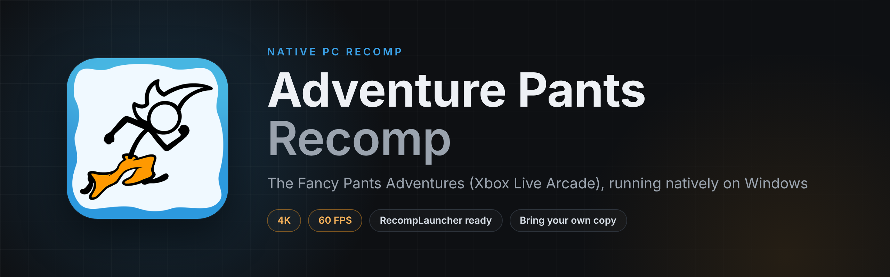
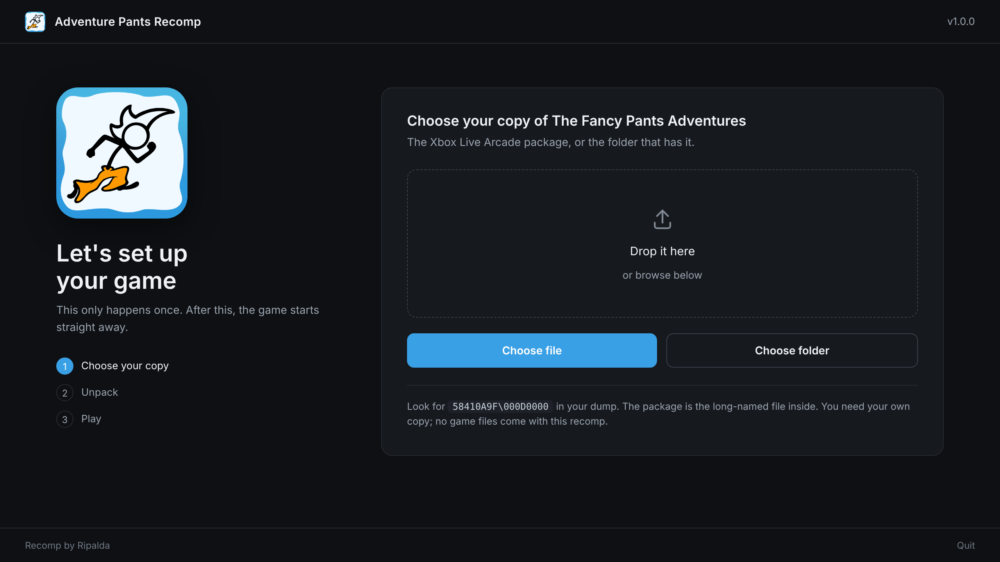

# Adventure Pants Recomp

**The Fancy Pants Adventures (Xbox Live Arcade) running natively on Windows**, recompiled from the Xbox 360 game with ReXGlue. Up to 4K at a locked 60 FPS, set up from your own copy in a couple of clicks.

## Get it on RecompLauncher
The easiest way to play is **[RecompLauncher](https://recomplauncher.com)**. It installs the recomp, finds your copy, sets it up and keeps it updated, with every setting on the game's page.

## What's in it
- The Xbox Live Arcade game recompiled to native PC code, not emulated
- Up to 4K, holding 60 FPS
- A setup screen on first launch: drop in your package or its folder and it's ready
- Settings for resolution (720p, 1440p, 4K), anti-aliasing, 16x texture filtering, V-Sync and variable refresh
- Escape switches between fullscreen and a window
- An FPS counter, off by default
- Works with Xbox, PlayStation and most other controllers
- Full RecompLauncher support: Easy Setup, settings in the launcher and save backups

## What you need
- Windows 10 or 11 (64-bit) and a DirectX 12 graphics card
- Your **own** copy of The Fancy Pants Adventures for **Xbox Live Arcade**. No game files are included.

## Which files work
| | File name | Size |
|---|---|---|
| Xbox Live Arcade package | `6BD7BB6917CE7BC0B816C280ACFD9BD78471228258` | 409,088,000 bytes (390 MB) |

The package has no file extension. That's normal, so leave the name as it is. In a dump it sits in `58410A9F/000D0000/`. You can pick the package itself or the folder that holds `58410A9F`.

> [!TIP]
> ### 💙 Enjoying the recomp?
> If you've gotten some enjoyment out of this project, donations and love are always appreciated. Every bit helps keep these projects growing. Thank you!
>
> 

## Install by hand
1. Download `AdventurePantsRecomp-v1.0.0-Windows-x64.zip` from [Releases](../../releases) and unzip it anywhere.
2. Run `AdventurePantsRecomp.exe`.
3. On the setup screen, drop in your package or its folder, or use Choose file. It unpacks once (about 390 MB) and the game starts.

To update, unzip the new version over the old one. Your game files, saves and settings stay.

## Controls
| Key | Does |
|---|---|
| Controller | Same as the Xbox 360 version |
| Escape | Fullscreen or windowed |
| F3 | Performance overlay |

## Settings
Change them on the game's page in RecompLauncher, or in `AdventurePantsRecomp.toml` next to the exe:

| Setting | Values |
|---|---|
| `resolution_scale` | `1` 720p, `2` 1440p, `3` 4K |
| `swap_post_effect` | `"none"`, `"fxaa"`, `"fxaa_extreme"` |
| `anisotropic_override` | `-1` game's own, `2` to `5` (5 is 16x) |
| `fullscreen`, `vsync`, `show_fps` | `true` or `false` |

Saves are in `Documents\AdventurePantsRecomp`.

## Reporting a problem
Report bugs on the **[RIPALDA Discord](https://discord.gg/GgDE5Vynyu)**. Send the newest file from the `logs` folder next to the exe, with what you were doing and your settings.

## Building from source
The whole source is in this repository. See [BUILDING.md](BUILDING.md). You need your own copy of the game to build it, and nothing from the game is stored here.

## Credits
- **[elripalda](https://github.com/elripalda)**: the recomp, the setup screen, the RecompLauncher support and the art
- **[ReXGlue](https://github.com/rexglue/rexglue-sdk)**: the static recompiler and runtime, which builds on [Xenia](https://github.com/xenia-project/xenia) and [XenonRecomp](https://github.com/hedge-dev/XenonRecomp)
- [SDL3](https://github.com/libsdl-org/SDL) and [Dear ImGui](https://github.com/ocornut/imgui)
- The Fancy Pants Adventures was created by Brad Borne

## License
This recomp's own code is under the [GPL-3.0](LICENSE). ReXGlue keeps its own BSD-style license. Neither covers the game, its artwork or its music.

*An unofficial fan project, not affiliated with or endorsed by Brad Borne, Over the Top Games, Electronic Arts or Microsoft. No game files are included.*
